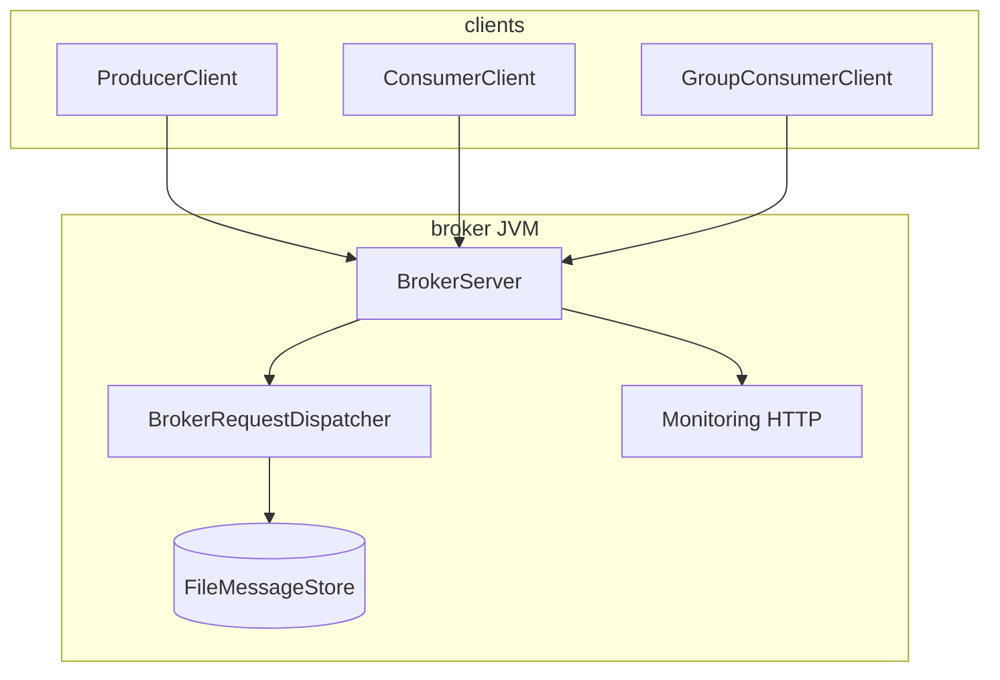

# JavaStream

**JavaStream** is a Kafka-inspired distributed message broker written in Java: custom **JSTR** wire protocol, durable **segment logs**, **consumer groups**, **multi-broker replication**, optional **security**, and **Prometheus** metrics.



## Features

| Area | Status |
|------|--------|
| Topics, produce, fetch, consumer ack | Implemented |
| Durable log segments + recovery | Implemented |
| Consumer groups (join, heartbeat, commit) | Implemented |
| Multi-broker replication + failover | Implemented (educational consensus) |
| Delivery ack levels, high watermark | Implemented |
| Monitoring (`/health`, `/ready`, `/metrics`) | Implemented |
| Optional auth, ACLs, TLS (server) | Implemented; TLS partial — see [SECURITY.md](SECURITY.md) |
| Docker multi-stage image + Compose | Implemented |
| Kafka protocol compatibility | **Not** implemented (custom protocol only) |

## Requirements

- Java **26**
- Maven **3.9+** (or `./mvnw`)

## Build and test

```bash
./mvnw clean verify
```

Artifacts:

- `target/javastream-0.1.0-SNAPSHOT.jar`
- `target/javastream-0.1.0-SNAPSHOT-jar-with-dependencies.jar` (recommended for `java -jar`)

## Run a broker (local)

```bash
./mvnw -q package
java -jar target/javastream-0.1.0-SNAPSHOT-jar-with-dependencies.jar
```

Defaults: client **9092**, monitoring **8080**, data **`./data`**, logs **`./logs`**.

Override via environment (see [CONFIGURATION.md](CONFIGURATION.md)):

```bash
export JAVASTREAM_NETWORK_LISTEN_PORT=19092
export JAVASTREAM_STORAGE_DATA_DIR=/tmp/javastream-data
java -jar target/javastream-0.1.0-SNAPSHOT-jar-with-dependencies.jar
```

Stop with **Ctrl+C** or **SIGTERM**; the shutdown hook calls `JavaStreamServer.stop()` for graceful socket drain.

## Docker

Build and run a **single** broker:

```bash
cp .env.example .env   # COMPOSE_PROFILES=single
docker compose --profile single up -d --build
curl -fsS http://127.0.0.1:8080/health
```

**Three-broker cluster** (replication factor 3):

```bash
COMPOSE_PROFILES=cluster docker compose --profile cluster up -d --build
# Client ports: 9092 (broker-0), 9094 (broker-1), 9096 (broker-2)
# Monitoring: 8080, 8081, 8082
```

Data and logs use named volumes (`broker-*-data`, `broker-*-logs`). Image: multi-stage [Dockerfile](Dockerfile), health check on `/health`, `STOPSIGNAL SIGTERM`.

## Client examples

Point examples at a running broker (default `127.0.0.1:9092`):

```bash
export JAVASTREAM_EXAMPLE_BROKER_HOST=127.0.0.1
export JAVASTREAM_EXAMPLE_BROKER_PORT=9092
```

| Example | Main class |
|---------|------------|
| Producer | `com.javastream.examples.ProducerExample` |
| Consumer | `com.javastream.examples.ConsumerExample` |
| Multiple producers | `com.javastream.examples.MultipleProducersExample` |
| Multiple consumers | `com.javastream.examples.MultipleConsumersExample` |
| Consumer group | `com.javastream.examples.ConsumerGroupExample` |
| Topic creation + list | `com.javastream.examples.TopicCreationExample` |
| Low-level produce/fetch | `com.javastream.examples.PublishAndFetchExample` |
| Embedded broker demo | `com.javastream.examples.ProducerConsumerExample` |

```bash
./scripts/run-examples.sh com.javastream.examples.ProducerExample
./mvnw -q exec:java -Dexec.mainClass=com.javastream.examples.ConsumerGroupExample
```

High-level APIs: `com.javastream.producer.ProducerClient`, `com.javastream.consumer.ConsumerClient`, `com.javastream.consumer.GroupConsumerClient`.

## Documentation

| Document | Contents |
|----------|----------|
| [ARCHITECTURE.md](ARCHITECTURE.md) | Layers, packages, dependency rules |
| [PROTOCOL.md](PROTOCOL.md) | JSTR v1 framing and payloads |
| [STORAGE_ENGINE.md](STORAGE_ENGINE.md) | On-disk layout and recovery |
| [REPLICATION.md](REPLICATION.md) | Cluster and replication model |
| [CONFIGURATION.md](CONFIGURATION.md) | Keys and env mapping |
| [BENCHMARKS.md](BENCHMARKS.md) | How to benchmark |
| [BENCHMARK_REPORT.md](BENCHMARK_REPORT.md) | Measured results |
| [CONSUMER_GROUPS.md](CONSUMER_GROUPS.md) | Group vs independent consumers |
| [DELIVERY_GUARANTEES.md](DELIVERY_GUARANTEES.md) | Ack levels |
| [SECURITY.md](SECURITY.md) | Auth, ACL, TLS |
| [CONTRIBUTING.md](CONTRIBUTING.md) | Dev workflow |
| [RELEASE_REPORT.md](RELEASE_REPORT.md) | Phase 13 release summary |

## Monitoring

When `monitoring.http.port > 0`:

| Path | Purpose |
|------|---------|
| `/health` | Liveness JSON `{"status":"UP"}` |
| `/ready` | Readiness after broker start |
| `/metrics` | Prometheus text exposition |
| `/admin/*` | Operator JSON API (optional token) |

## Known limitations

- Not suitable as a drop-in Apache Kafka replacement (different protocol and ops model).
- Cluster coordinator is a single broker id — not fault-tolerant membership service.
- Replication and client redirect semantics are best-effort; see [REPLICATION.md](REPLICATION.md).
- High-level clients do not auto-authenticate when security is enabled.
- License: TBD.

## License

TBD.
