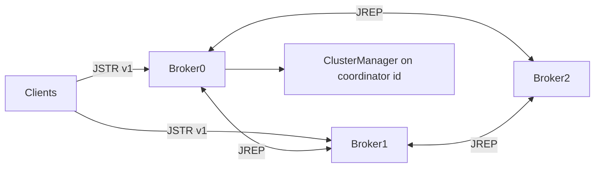

# Replication and clustering

> **Educational implementation** — not production-grade consensus. For narrative aligned with tests, this document consolidates [CLUSTER_REPLICATION.md](CLUSTER_REPLICATION.md).

## Modes

| `cluster.enabled` | Behaviour |
|-------------------|-----------|
| `false` | Single `TcpBrokerNode`; local `FileMessageStore` only |
| `true` | `ClusterBrokerNode`: client listener + inter-broker `JREP` protocol |

## Architecture

The **coordinator** is the broker whose `broker.id` equals `cluster.coordinator.id` (not a separate JVM).

## Consistency (summary)

- **Leader election:** smallest live broker id in the replica set; failover on heartbeat timeout.
- **ISR:** lag-based; followers removed when replicate RPCs fail.
- **High watermark:** derived from minimum log end across ISR.
- **Producer acks:** `ACK_ALL_REPLICAS` waits for assigned followers (best-effort).
- **Non-leader produce:** returns `BAD_REQUEST` — clients must target the partition leader.

## Configuration checklist (three brokers)

1. Unique `broker.id` per process
2. Fixed `network.replication.port` on each broker (required in Docker)
3. Followers: `cluster.coordinator.host` + `cluster.coordinator.port` pointing at broker 0’s replication port
4. `cluster.replication.factor` ≤ number of brokers

Example: [docker-compose.yml](docker-compose.yml) profile `cluster`.

## Operations

- Graceful shutdown: SIGINT/SIGTERM → JVM shutdown hook → `ClusterBrokerNode` drains replication sessions (`gracefulClusterShutdown`).
- Follower restart: re-register, assignment push, `ReplicationEngine` catch-up fetch.

## Not implemented / limitations

- No Raft, ZAB, or KRaft-style quorum
- Coordinator availability is a single point of failure for membership updates
- Inter-broker traffic is plaintext (no TLS on replication port)
- Automatic client redirect to partition leader is limited — callers should use metadata responses or known leader ids

## Tests

- `ClusterReplicationIntegrationTest` — three brokers, replication, restart, failover
- `FaultToleranceIntegrationTest` — broker loss scenarios
